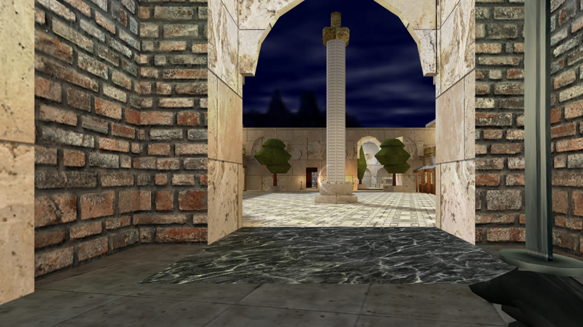
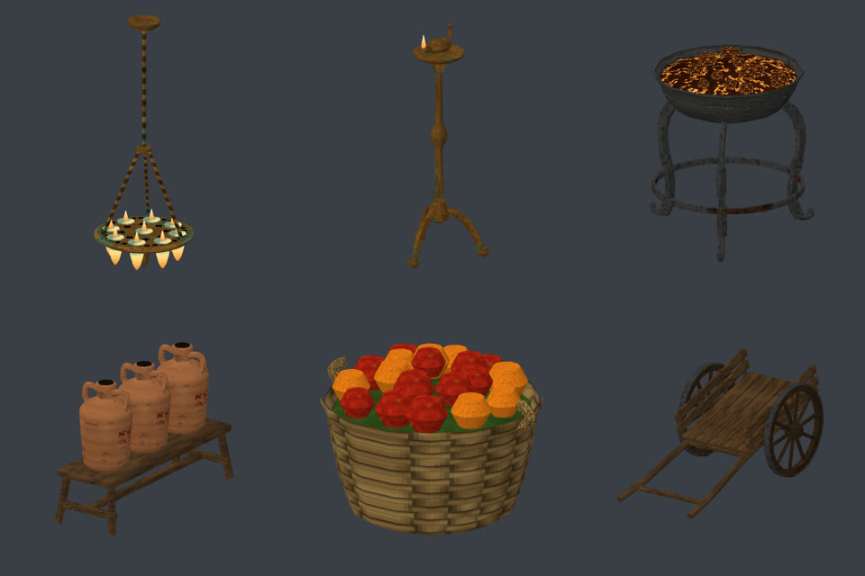
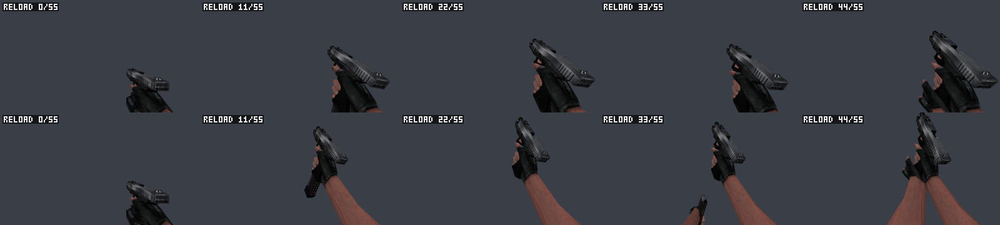

# SMAK: Studio Model Agent Kit

SMAK is a toolkit for AI coding agents, such as Claude Code or any agent that runs commands and looks at pictures. It
makes content for **GoldSrc games**, Half-Life and its mods: maps, models, animations and textures. The agent writes
short scripts with it and draws what it made to check its own work. The person it works for then plays the result in
their game.




*plaza-01, a forum for a role-play server of The Specialists on Xash3D. An agent wrote it as a script with SMAK; its
owner walked it in the game and kept it.*

## What 1.0 means

SMAK reaches 1.0 when an agent using it delivers work the person keeps, after judging it in their own game. A count of
features does not decide it. Three kinds of work passed that test:

**A map.** The agent worked from references, such as real late Roman forums and the mod's own maps. It made a plan,
and the person approved it before the first brush. It then wrote the map as a script, compiled it, and ran its
checks: the walk test, light, doors, sky gaps, and how much the engine draws. Its owner walked the map three times,
and each round fixed what that walk found.

**Models.** Curved things a brush cannot make well, built from nothing: a hanging lamp, a lampstand, a brazier,
amphorae on a rack, baskets, a handcart. Each was sized from a museum piece. The parts are turned on a lathe or swept
along curves, and the textures are painted by the script. Every model is measured against Half-Life's own props, so
that none of them is a pile of boxes.



**Animations, played in the game:**
- A katana's blows. The game's own horizontal cut was kept; the other two cuts follow a real game's arm and lead with
  the edge.
- A pistol's reload. The game's version happens below the screen, so the player saw a tilted gun that did nothing for
  a second. The new one brings it into view.
- A run whose feet no longer skate, applied to all 147 player models.



*The reload at the player's own eye (fov 80, 16:9): the game's own above, SMAK's below.*

What the kit contributed is the eyes and the instruments; it is not a generator:
- **The game's eye:** every frame drawn as the player sees it.
- **A viewer** that plays a run over a floor moving at the game's speed, so a sliding foot shows.
- **A motion judge** that names pops, stalls, an elbow no shoulder could reach, and a blade that cuts with its flat.

The person's own words about direction caught what no number did, and the guide to animation now starts there.

## How it works

1. You say what you want: "a darker, more worn katana", "a market for the forum", "a reload you can see".
2. The agent reads `AGENTS.md`, finds the one guide the task needs, writes a short script with the kit, and runs it.
3. SMAK builds the model or map, checks it against the engine's limits and the game's own rules, and draws it.
4. The agent looks at the pictures and fixes what is wrong. You judge the result in your game.

SMAK reads and writes the game's files directly. It needs no decompiler, no studiomdl and no Blender, and there is
nothing to install.

## Start

1. Install [Node.js](https://nodejs.org) 18 or later.
2. Check the kit: `npm test` (`node test/selftest.mjs`) should end with `0 failed`. That is the fast suite, about a
   minute. `npm run test:slow` runs every area and is meant for before a release.
3. Start your agent inside the `smak` folder, or tell it: *"Read `smak/AGENTS.md`. My mod's models are in
   `C:\…\mymod\models`."* Ask for something small first, such as a texture change.

```
node bin/smak.mjs info   model.mdl                  what is in a model
node bin/smak.mjs sheet  model.mdl -o sheet.png     six views of it
node bin/smak.mjs check  model.mdl                  would the engine load it
node bin/smak.mjs form   model.mdl                  how boxy it is, beside Half-Life's own
node bin/smak.mjs motion v_gun.mdl --seq reload     an animation's faults: pops, stalls, arms, foot slide
node bin/smak.mjs view   originals/ mine/           side by side in the browser; "game's eye" and "travel"
node bin/smak.mjs map-battery map.bsp               every player-facing check of a compiled map
node bin/smak.mjs help                              all 63 commands
```

## Guides

| | |
| --- | --- |
| [AGENTS.md](AGENTS.md) | The agent's briefing, kept short: the loop, the rules, and which guide a task needs. |
| [docs/COMMANDS.md](docs/COMMANDS.md), [docs/API.md](docs/API.md) | Every command, and every function. |
| [docs/MODELS.md](docs/MODELS.md), [RESKIN.md](docs/RESKIN.md), [SHAPES.md](docs/SHAPES.md) | How a model is put together and how to make a new one; re-skins; new shapes in a model. |
| [docs/ANIMATION.md](docs/ANIMATION.md) | An animation the person keeps: the game's eye, key poses first, a reference game's arm, the copy into the game. |
| [docs/MAPS-DESIGN.md](docs/MAPS-DESIGN.md), [MAPS-MAKING.md](docs/MAPS-MAKING.md), [MAPS-SKETCH.md](docs/MAPS-SKETCH.md) | Designing a map, writing it as a script, making one from a drawing. |
| [docs/MAPS-LOOKING.md](docs/MAPS-LOOKING.md), [MAPS-CHECKS.md](docs/MAPS-CHECKS.md), [MAPS.md](docs/MAPS.md) | Looking at a map, checking it, and the format in depth. |
| [docs/PLAY.md](docs/PLAY.md) | Playing a map in the game, testing it by what the game says, and filming it. |
| [docs/IMPORT.md](docs/IMPORT.md), [docs/ITEMS.md](docs/ITEMS.md) | Bought models, and new weapons in a game's own files. |
| [docs/SOUNDS.md](docs/SOUNDS.md), [SPRITES.md](docs/SPRITES.md), [ENGINES.md](docs/ENGINES.md) | Sounds, sprites, and GoldSrc compared with Xash3D. |
| [docs/TROUBLE.md](docs/TROUBLE.md) | What the kit can and cannot do, and what a message means when something is wrong. |
| [ARCHITECTURE.md](ARCHITECTURE.md), [CHANGELOG.md](CHANGELOG.md) | How the kit is laid out and why; what changed, version by version. |

## Earlier work

[](https://github.com/Deoroot/smak/releases/download/v0.26.0/smak-demo.mp4)

**[Watch the 3-minute showcase](https://github.com/Deoroot/smak/releases/download/v0.26.0/smak-demo.mp4)** (0.26).
Every model, map and shot in it was made by an agent with SMAK. It shows Moria for Master Sword Classic: a walled town
with an orchard, a four-round defence, and a boss who falls, rises and falls again. The town was written as a script,
compiled, walk-tested, and played in the game by the agent before anyone else.

## Limits

- Made for GoldSrc: model version 10, map version 30, and BSP2 for Xash3D.
- One bone per vertex, as the format has it. Animations kept in `name01.mdl` files are read, not edited.
- The kit's pictures use a plain light of their own: shape, size, texture and pose are true, brightness is not. Timing,
  and how a weapon sits in the hand while moving, show only in the game.
- The ports to Source (Garry's Mod) and s&box, from 0.29 to 0.37, and the city generator are not in 1.0. They are kept
  on the branches `dormant/0.38` and `dormant/0.39-generators`.
- It does not ship any game's content. A game's models and textures belong to its authors.

## Licence

The kit's code is under the MIT licence (see `LICENSE`). What you make from a game's files is for that game's authors
to allow. SMAK began as the tooling of the msr-web project (Master Sword Classic in the browser).
